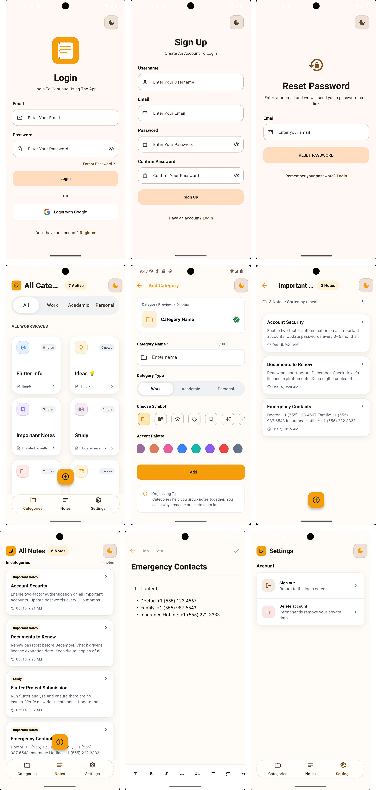

# Notes Management

A Flutter notes app for capturing, organizing, and managing personal notes. Notes
are grouped into customizable categories, with Firebase providing authentication
and cloud storage.

## App preview



## Features

- Create an account and sign in with email and password or Google.
- Require email verification for email-based accounts.
- Reset a forgotten password by email.
- Create, edit, and delete notes, including rich-text formatting and links.
- Organize notes into categories with a type, symbol, and accent color.
- Filter categories by type and browse notes across categories.
- Switch between light and dark themes; the theme preference is saved locally.
- Manage the account, including signing out and deleting account data.
- Store user, category, and note data in Cloud Firestore with owner-based access
  rules.

## Built with

- [Flutter](https://flutter.dev/) and Dart
- [Firebase Authentication](https://firebase.google.com/products/auth)
- [Cloud Firestore](https://firebase.google.com/products/firestore)
- [Flutter Quill](https://pub.dev/packages/flutter_quill) for rich-text editing

## Requirements

- Flutter SDK compatible with the Dart constraint in `pubspec.yaml`
- A Firebase project with Authentication and Cloud Firestore enabled
- Platform tooling for the target you want to run (for example, Android Studio
  for Android)

## Getting started

1. Clone this repository and open its root directory:

   ```bash
   git clone https://github.com/KottiMahdi/Notes-Flutter.git
   cd Notes-Flutter
   ```

2. Install dependencies:

   ```bash
   flutter pub get
   ```

3. Configure Firebase for your Firebase project. Enable Email/Password and
   Google sign-in providers in Firebase Authentication, create a Cloud Firestore
   database, and configure the platforms you intend to run. If needed, use the
   [FlutterFire CLI](https://firebase.google.com/docs/flutter/setup) to generate
   `lib/firebase_options.dart`.

4. Deploy the Firestore rules from this repository:

   ```bash
   firebase deploy --only firestore:rules
   ```

5. Run the app on a connected device or emulator:

   ```bash
   flutter run
   ```

## Validation

Run the analyzer and test suite from the project root:

```bash
flutter analyze
flutter test
```

## Security and environment configuration

The app currently uses one Firebase project. Firebase values in
`lib/firebase_options.dart` and `android/app/google-services.json` are
**public client configuration**, not private credentials. They are required
by client SDKs and can be extracted from a released app. Do not treat moving
them to `.env` or `--dart-define` as a way to make them secret. Restrict the
Google API keys to the app identifiers and required APIs, and enforce access
with Firebase Authentication, Firestore Security Rules, and App Check.

No backend base URL or private API token is currently used, so there is no
runtime configuration to move into `.env`. `.env.example` is a placeholder
for a future backend endpoint and is not loaded by the app. If one is added,
use HTTPS and load development/staging/production values at build time; never
commit the actual environment file. Keep genuinely sensitive credentials on a
backend.

For separate Firebase environments, create separate Firebase projects and
register the target app identifiers in each project. Generate and select the
corresponding `FirebaseOptions` for each build flavor with the FlutterFire CLI;
do not point a build labeled “staging” at the production project. This
repository currently has only the generated options for its configured
project, so separate Firebase environments require those additional project
configurations before they can be built.

For Android release builds, enable Flutter obfuscation and retain the symbol
files privately for crash symbolication:

```bash
flutter build appbundle --release --obfuscate --split-debug-info=build/symbols
flutter build apk --release --obfuscate --split-debug-info=build/symbols
```

The Android release build already enables R8 via `minifyEnabled true` and uses
the optimized default ProGuard rules. Add narrowly scoped keep rules only if a
release test demonstrates that a plugin needs them; do not disable shrinking
globally. Obfuscation and R8 make reverse engineering harder, but do not hide
secrets embedded in the app.

## Project layout

```text
lib/
  controllers/    Application logic for authentication, categories, and notes
  core/           Shared utilities, widgets, and error handling
  models/         User, category, and note data models
  services/       Firebase and local preference integrations
  views/          Authentication, category, notes, and settings screens
assets/img/       App images and the README screenshot
```

## Android release builds

Release signing uses a local keystore at
`android/release/upload-keystore.jks`, which is excluded from source control.
Create `android/key.properties` from `android/key.properties.example` and add
the credentials for that keystore:

```properties
storeFile=release/upload-keystore.jks
storePassword=YOUR_KEYSTORE_PASSWORD
keyAlias=YOUR_KEY_ALIAS
keyPassword=YOUR_KEY_PASSWORD
```

For CI, provide `ANDROID_KEYSTORE_FILE`, `ANDROID_KEYSTORE_PASSWORD`,
`ANDROID_KEY_ALIAS`, and `ANDROID_KEY_PASSWORD` as protected secrets. The
release build does not fall back to the debug signing key.

Build the Android release artifacts with:

```bash
flutter build apk --release
flutter build appbundle --release
```
